# Telemetry-driven fix agent chain (Azure + multi-repo GitHub)

## Context

- **Input**: Normalized failure records from a **Log Analytics workspace** (Kusto queries over `AppRequests`, `AppExceptions`, `AppTraces`, dependencies, etc.) containing stack traces and telemetry dimensions (`cloud_RoleName`, `cloud_RoleInstance`, `operation_Id`, custom dimensions, resource IDs).
- **Code**: **Multiple GitHub repositories** (typical: one repo per Azure-deployed service or bounded context).
- **Verification**: **CI on the PR** (GitHub Actions and/or Azure DevOps pipeline triggered by the branch/PR) is the authoritative “re-run” signal—no mandatory staging replay in this design.

## High-level flow

```mermaid
flowchart LR
  subgraph ingest [Ingestion]
    LA[LogAnalytics_Kusto]
    Norm[Normalize_and_structured_error]
  end
  subgraph route [Routing]
    Reg[Service_to_repo_registry]
    Pick[Target_repo_and_paths]
  end
  subgraph analyze [Analysis]
    Triage[Triage_and_hypothesis]
    Map[Code_and_infra_mapper]
    Investigate[Deep_investigation]
  end
  subgraph fix [Remediation]
    Patch[Implement_fix_and_tests]
    PR[Branch_commit_open_PR]
  end
  subgraph verify [Verification]
    CI[CI_on_PR]
    Report[Outcome_to_operator]
  end
  LA --> Norm --> Reg --> Pick --> Triage --> Map --> Investigate --> Patch --> PR --> CI --> Report
```

## Agent roles (recommended chain)

Each “agent” is a **specialized step** with a tight system prompt, tool allowlist, and structured JSON handoff to the next step. A thin **orchestrator** (e.g. LangGraph-style state machine or Azure Logic Apps + Functions) enforces ordering, retries, and human gates.

| Step | Agent name                   | Responsibility                                                                                                                                                                                                                                                                                | Key tools / integrations                                                                        |
| ---- | ---------------------------- | --------------------------------------------------------------------------------------------------------------------------------------------------------------------------------------------------------------------------------------------------------------------------------------------- | ----------------------------------------------------------------------------------------------- |
| 0    | **Ingestion normalizer**     | Pull selected incidents (scheduled or event-driven), flatten to a canonical schema: exception type/message, stack frames, `cloud_RoleName`, `operation_Id`, timestamps, deployment version/build id if present, resource/subscription hints.                                                  | Azure Monitor REST / Kusto (Managed Identity), optional Event Grid on alert                     |
| 1    | **Service router**           | Map telemetry identity → **target GitHub repo(s)** and optional path prefixes. Uses a **registry** (YAML/JSON in this repo or Azure App Configuration): `cloud_RoleName` / App Service name / Function app name / container image → `org/repo`, default branch, CI workflow IDs, code owners. | Read registry; optional Azure Resource Graph to enrich “what is this role?”                     |
| 2    | **Triage / hypothesis**      | Classify: app bug vs dependency vs config vs infra; extract search anchors (exception text, HTTP status, dependency name, SQL fragment). Output a short hypothesis + confidence.                                                                                                              | LLM only + structured output schema                                                             |
| 3    | **Code & infra mapper**      | Given hypothesis + stack, locate **candidate files** in the **routed repo**: symbol search, path heuristics, `cloud_RoleName` → project folder conventions. If stack is obfuscated/minified, note limitation and widen search.                                                                | GitHub Contents/Search API, clone + ripgrep in ephemeral workspace                              |
| 4    | **Investigator**             | Read files, trace call path, correlate with Bicep/ARM/Terraform in **that repo** if the failure looks like misconfiguration (connection strings, feature flags, Key Vault refs). Produce: root cause summary, exact edit locations, test ideas.                                               | Read-only repo access, optional Azure read-only checks (e.g. compare app setting names to code) |
| 5    | **Implementer**              | Apply minimal code/config change + **tests** (unit or integration as appropriate). Enforce repo conventions (lint/format).                                                                                                                                                                    | Git write in worktree, test runner                                                              |
| 6    | **PR publisher**             | Create branch, commit, open PR with: summary, linked incident id, repro steps from telemetry, risk notes. Label reviewers from CODEOWNERS or registry.                                                                                                                                        | GitHub API (PAT or GitHub App installation)                                                     |
| 7    | **CI verifier / summarizer** | Poll PR checks; parse workflow conclusion; on failure, feed logs back to a **narrow “fix CI” loop** (bounded retries) or stop with human handoff.                                                                                                                                             | GitHub Checks API, optional workflow log download                                               |
| 8    | **Reporter**                 | Post outcome to Teams/Slack/email or work item (Azure DevOps / GitHub Issue): PR link, CI status, residual risk.                                                                                                                                                                              | Webhook connectors                                                                              |

**Human-in-the-loop (recommended for production)**: require approval before step 5 (patch) or before step 6 (PR), depending on risk tolerance.

## Multi-repo critical design: service registry

Without this, routing will be unreliable. Maintain a single source of truth, for example:

- `services.yaml` keyed by `cloud_RoleName` (and aliases), each entry: `github: org/repo`, `path_filters`, `primary_language`, `test_command`, `required_checks`, `deployment_correlation` (build id dimension name if any).

The **Service router** agent only decides among registry entries; it does not guess repos from scratch.

## Azure placement options for the orchestrator

- **Azure Container Apps / App Service / Function App** running the orchestrator, using **Managed Identity** to query Log Analytics and read App Configuration / Key Vault.
- **GitHub**: use a **GitHub App** (preferred over long-lived PATs) for repo clone, PR creation, and checks read—install only on allowed orgs/repos.
- **Secrets**: incident payloads may contain PII; redact in the normalizer and store correlation IDs only where possible.

## Data contract between agents (suggested)

A shared JSON state object passed along the chain, e.g.:

- `incident`: ids, time range, raw + redacted stack
- `routing`: `org/repo`, branch, path hints
- `hypothesis`: text, confidence, category
- `evidence`: file paths + line ranges + snippets
- `patch`: diff summary, files changed
- `pr`: url, branch
- `ci`: check runs, final conclusion, log excerpts

## Failure modes to plan for

- **Ambiguous routing**: multiple repos match → orchestrator escalates or runs **parallel read-only** investigation branches then merges findings.
- **No stack / obfuscated**: Investigator widens to logs correlation (`operation_Id`) and recent deployments.
- **Infra-only root cause**: Implementer changes IaC in the same repo; CI validates `terraform plan` / ARM what-if if you add those jobs later.
- **CI flaky**: verifier distinguishes **new failures vs known flakes** using baseline main-branch behavior (optional enhancement).

## What to build first in this repo ([TelemetryBot](c:\Users\sd190\OneDrive\Documents\GitHub\TelemetryBot))

1. **Canonical incident schema** + Kusto query templates for exceptions tied to failed requests.
2. **Service registry** format + validation script.
3. **Orchestrator skeleton** (state machine) with stub agents and real GitHub + Kusto integrations behind interfaces.
4. **GitHub App** auth path and minimal “open PR from patch” path.
5. **CI verifier** module that waits for required checks and returns structured success/failure.

## Out of scope for this iteration (per your choices)

- Automated staging deploy and request replay (can be a later **Verification** agent upgrade).
- Auto-merge of PRs (keep as explicit human or policy decision).

